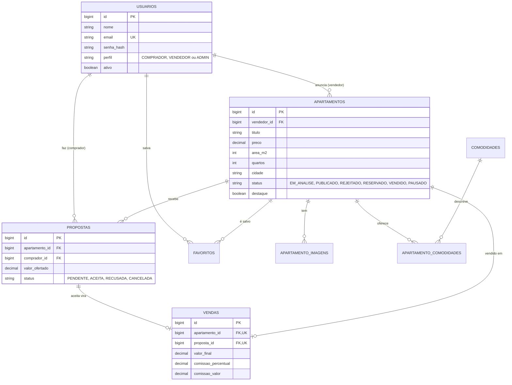

# Andar Alto — e-commerce de apartamentos

Loja virtual para **venda de apartamentos** (somente apartamentos), com **imagens 100% fictícias**
e três tipos de usuário: **comprador**, **vendedor** e **administrador**.
Feito com **Java 17 + Spring Boot 3.5 + Thymeleaf + Spring Data JPA + Spring Security + Flyway + H2**.

> Projeto de estudo: todas as pessoas, anúncios e imagens são fictícios e nenhum negócio real é fechado.

---

## 1. Como rodar

Você precisa de **JDK 17 ou mais novo** e **Maven 3.9+** (ou uma IDE com Maven: IntelliJ, VS Code, Eclipse).

```bash
cd imoveis-ecommerce
mvn spring-boot:run
```

Abra **http://localhost:8080**. Na IDE, basta executar a classe `com.andaralto.ImoveisApplication`.

Na primeira execução o sistema cria o banco, o administrador e uma vitrine de demonstração
(14 anúncios em todas as situações, propostas, favoritos e uma venda concluída).

| Perfil        | E-mail                    | Senha      |
|---------------|---------------------------|------------|
| Administrador | `admin@andaralto.com`     | `admin123` |
| Vendedora     | `carla@andaralto.demo`    | `demo123`  |
| Vendedor      | `roberto@andaralto.demo`  | `demo123`  |
| Compradora    | `ana@andaralto.demo`      | `demo123`  |
| Comprador     | `bruno@andaralto.demo`    | `demo123`  |
| Compradora    | `marina@andaralto.demo`   | `demo123`  |

- **Recomeçar do zero:** pare a aplicação e apague a pasta `data/`.
- **Começar sem dados de demonstração:** `app.demo.dados=false` em `application.properties`.
- **Rodar os testes:** `mvn test` (usa um banco em memória, não mexe na pasta `data/`).

### Primeira execução: leia isto

**Status (21/10/2026):** o projeto foi executado com sucesso em um Windows com VS Code: compilou, o Flyway criou o
esquema, o JPA inicializou, o Tomcat subiu na porta 8080 e o administrador e os dados de demonstração foram criados.
Ainda **não foi rodado o `mvn test`** (os testes de integração) nem percorrido cada fluxo de tela na prática.

Antes disso, o ambiente em que o código foi escrito não tinha acesso ao Maven Central, então foram feitas
estas conferências estáticas (sem precisar do Spring):
- as classes em Java puro (enums de status, `FiltroBusca`, `GeradorSvg`, `CenaFicticia`) **compilam com `javac`**
  e o gerador produziu 32 ilustrações SVG, todas XML válido;
- **entidades JPA × SQL**: cada coluna do `V1__criar_esquema.sql` tem o campo correspondente (e o Hibernate está em `ddl-auto=none`);
- **links dos templates × rotas dos controllers**: todos os `th:href`/`th:action` têm uma rota (42 rotas mapeadas);
- os 23 templates têm as tags HTML balanceadas;
- chamadas entre controller, service, repository e formulários (430 conferidas) apontam para métodos existentes.

Se aparecer qualquer erro na primeira execução, copie a mensagem completa: o problema costuma ser pequeno e localizado.

---

## 2. O que cada perfil faz

| Área / ação                                           | Visitante | Comprador | Vendedor | Admin |
|-------------------------------------------------------|:---------:|:---------:|:--------:|:-----:|
| Ver vitrine, buscar com filtros, abrir um anúncio     |     ✔     |     ✔     |    ✔     |   ✔   |
| Criar conta (comprador ou vendedor)                   |     ✔     |           |          |       |
| Favoritar apartamentos                                |           |     ✔     |          |       |
| Enviar, acompanhar e cancelar propostas               |           |     ✔     |          |       |
| Criar, editar, pausar, reativar e excluir **os seus** anúncios |  |           |    ✔     |       |
| Aceitar/recusar propostas, concluir venda, ver vendas |           |           |    ✔     |       |
| Aprovar/rejeitar anúncios, destacar na vitrine        |           |           |          |   ✔   |
| Ativar/desativar usuários, gerir comodidades          |           |           |          |   ✔   |
| Ver todas as vendas e a comissão da plataforma        |           |           |          |   ✔   |
| Editar os próprios dados e trocar a senha             |           |     ✔     |    ✔     |   ✔   |

### Por que "proposta" e não "carrinho"?
Ninguém compra um apartamento com um clique. O "carrinho" de um imóvel é a **proposta**:
o comprador oferece um valor, o vendedor aceita ou recusa, e só então o negócio é concluído.

### Ciclo de vida do anúncio

```
EM_ANALISE --(admin aprova)--> PUBLICADO --(vendedor aceita proposta)--> RESERVADO --(vendedor conclui)--> VENDIDO
    |                           |   ^                                        |
    +--(admin rejeita)--> REJEITADO   +--(vendedor pausa/reativa) PAUSADO      +--(cancela a reserva)--> PUBLICADO
```

Proposta: `PENDENTE -> ACEITA | RECUSADA | CANCELADA`. Ao aceitar uma proposta, as demais pendentes do mesmo
apartamento são recusadas automaticamente. Ao concluir a venda, a **comissão da plataforma** (2%, configurável)
é calculada e gravada na própria venda, para o histórico não mudar se a taxa mudar depois.

---

## 3. Modelo do banco de dados

O esquema está em `src/main/resources/db/migration/V1__criar_esquema.sql` (o **Flyway** o executa sozinho).
É SQL padrão: roda no H2 (usado aqui) e no PostgreSQL.



| Tabela                     | Papel                                                                          |
|----------------------------|--------------------------------------------------------------------------------|
| `usuarios`                 | Todos os perfis; `perfil` define as permissões; senha só como hash BCrypt      |
| `apartamentos`             | Anúncios (preço, medidas, endereço, status, motivo de rejeição, destaque)      |
| `comodidades`              | Lista de itens (piscina, academia...) gerida pelo administrador               |
| `apartamento_comodidades`  | Ligação N:N entre anúncios e comodidades                                       |
| `apartamento_imagens`      | Imagens do anúncio (URL das ilustrações fictícias, com legenda e ordem)        |
| `favoritos`                | Ligação N:N entre comprador e anúncio                                          |
| `propostas`                | Ofertas dos compradores                                                        |
| `vendas`                   | Recibo da venda concluída, com a comissão congelada (um por apartamento)       |

Para mudar o banco depois, **nunca edite uma migração já aplicada**: crie a próxima (`V3__...sql`).

---

## 4. Como o código está organizado (para estudar)

```
src/main/java/com/andaralto
├── model/        Entidades JPA (classes ligadas às tabelas) e enums de status
├── repository/   Acesso ao banco: Spring Data gera o SQL a partir do nome dos métodos
├── service/      REGRAS do negócio (transições de status, comissão, quem pode o quê)
├── web/          Controllers (recebem o pedido e escolhem a página) e formulários
│   └── form/     Objetos que recebem os campos do HTML, com validação (@NotBlank, @Min...)
├── security/     Login: traduz o nosso Usuario para o Spring Security
├── config/       Segurança (quem acessa o quê), propriedades e dados de demonstração
├── imagem/       Gerador das ilustrações fictícias em SVG (Java puro)
└── exception/    Erros de regra de negócio e "não encontrado"

src/main/resources
├── db/migration/ Esquema do banco (Flyway)
├── templates/    Páginas Thymeleaf (por perfil) + fragments/ (topo, rodapé, cartão do imóvel...)
└── static/       CSS e JavaScript mínimo (sem bibliotecas)

src/test/java     Testes de integração: páginas por perfil e fluxo anúncio -> venda
```

**Caminho de um pedido:** navegador → `SecurityConfig` (pode acessar?) → *Controller* (valida o formulário)
→ *Service* (aplica as regras, dentro de uma transação) → *Repository* (grava/lê no banco) → *Template* (monta o HTML).

Conceitos que aparecem no código, com comentários explicando cada um:
JPA/Hibernate (`@Entity`, `@ManyToOne`, `@ManyToMany`, *lazy loading*, *dirty checking*),
Spring Data (consultas derivadas, `Specification` para filtros dinâmicos, paginação),
transações (`@Transactional`), migrações com Flyway, Bean Validation, Spring Security (papéis, BCrypt, CSRF),
Thymeleaf (fragmentos, formulários com `th:field`), *flash attributes* e o padrão *Post/Redirect/Get*.

---

## 5. Segurança: o que já está feito e o que falta

**Já está feito**
- Senhas guardadas com **BCrypt**, nunca em texto puro.
- **CSRF** ligado: todo formulário POST leva o token (o Thymeleaf insere sozinho com `th:action`).
- Acesso por perfil em duas camadas: `SecurityConfig` bloqueia as áreas e os *services* conferem se o anúncio ou
  a proposta pertence mesmo a quem pediu (evita trocar o `id` na URL para mexer no que é de outro: falha tipo *IDOR*).
- O cadastro público só aceita COMPRADOR ou VENDEDOR; o servidor confere, mesmo que o formulário seja adulterado.
- Saída escapada pelo Thymeleaf (`th:text`), sem `th:utext`: protege contra XSS.
- O "voltar para a página anterior" aproveita só o **caminho** do cabeçalho `Referer`, nunca um endereço completo
  (evita *open redirect*).
- Conta desativada pelo administrador não consegue entrar; ninguém desativa a própria conta.

**Falta, se um dia for para produção**
- Trocar a senha do administrador (`app.admin.senha`) e guardar segredos fora do código (variáveis de ambiente).
- HTTPS, limite de tentativas de login, política de senha mais forte, recuperação de senha por e-mail, auditoria.
- Banco PostgreSQL no lugar do H2 em arquivo; upload real de fotos (hoje são ilustrações geradas pelo sistema).
- A versão do Spring Boot (3.5.0) está fixa de propósito; em um projeto real, use a última versão estável.

---

## 6. Ideias para evoluir

1. Perfil de execução com **PostgreSQL** (o esquema SQL já é compatível) e **Docker Compose**.
2. **API REST** (`@RestController`) com JWT, mantendo as páginas atuais.
3. Upload real de fotos, mensagens entre comprador e vendedor, agendamento de visitas.
4. Mais testes (repositórios com `@DataJpaTest`, regras de borda) e pipeline de CI.

---

## 7. Colocar no ar (de graça)

Veja o passo a passo em **[DEPLOY.md](DEPLOY.md)**: código no GitHub, site no Render e banco PostgreSQL no Neon,
usando o `Dockerfile` e o perfil `prod` (`application-prod.properties`) que já estão no projeto.
O H2 em arquivo continua sendo o banco do dia a dia no seu computador.
Observação: a troca para PostgreSQL ainda **não foi testada** de ponta a ponta (o ambiente onde foi preparada
não consegue subir um PostgreSQL); o primeiro deploy é o teste real.
